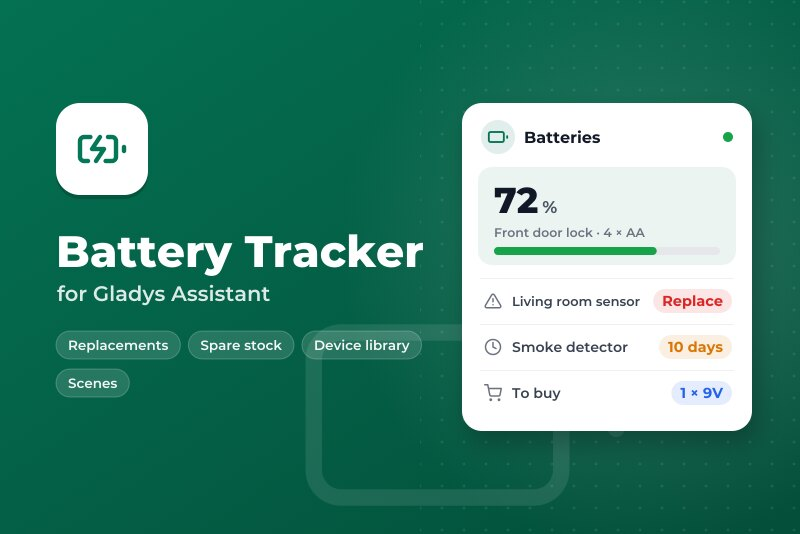
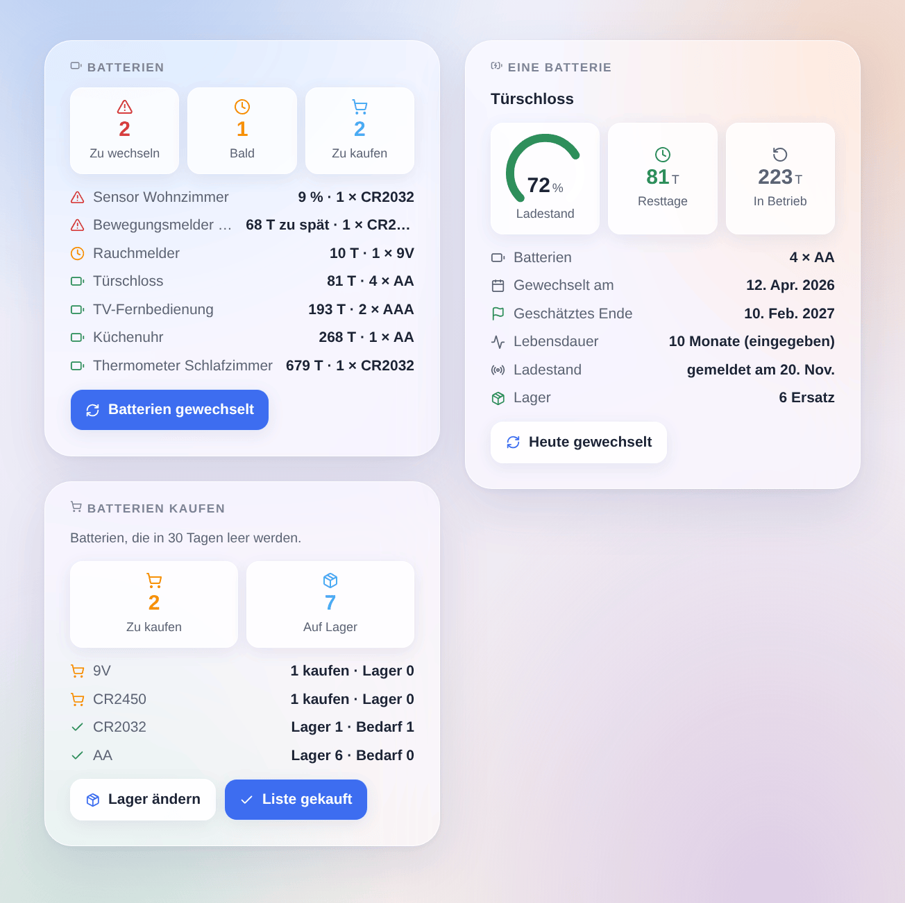
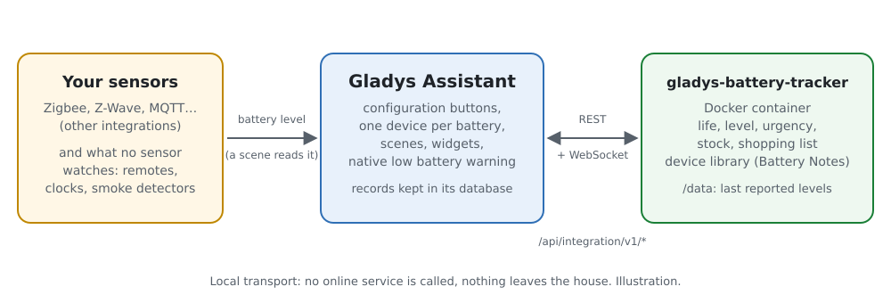
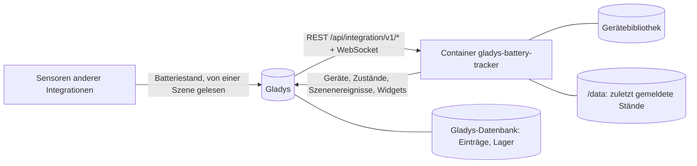
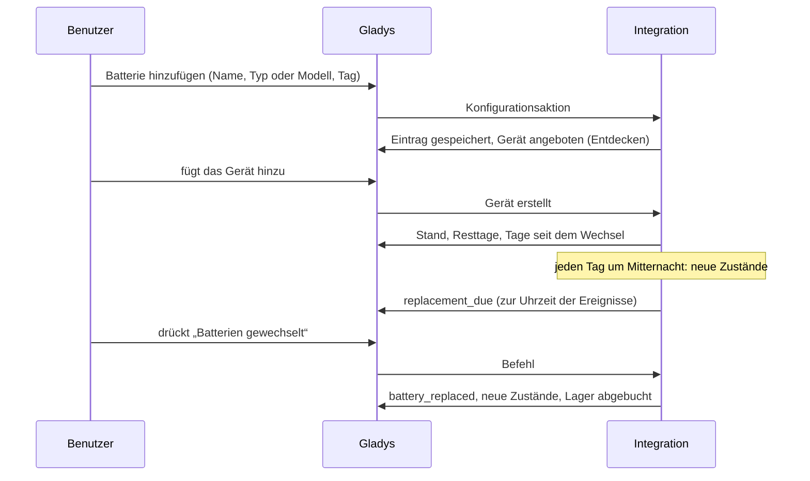

# Gladys Battery Tracker

[English](README.md) · [Français](README.fr.md) · **Deutsch** · [Español](README.es.md)

[](LICENSE)
[](https://github.com/William-De71/gladys-battery-tracker/releases)
[](https://github.com/William-De71/gladys-battery-tracker/actions/workflows/release.yml)
[](https://gladysassistant.com)



Externe Integration für [Gladys Assistant](https://gladysassistant.com), die die Batterien des Hauses im Blick behält, im Sinne der Home-Assistant-Integration [Battery Notes](https://github.com/andrew-codechimp/HA-Battery-Notes): Typ und Anzahl der Batterien jedes Geräts, Wechsel, geschätztes Ende, Ersatzlager und Einkaufsliste. Alles bleibt in Gladys: kein Onlinedienst, kein Konto.

Benutzerdokumentation: [English](docs/en.md) · [Français](docs/fr.md) · [Deutsch](docs/de.md) · [Español](docs/es.md).

## Funktionen

- **Ein Gerät pro Batterie-Eintrag**, hinzugefügt über den Bildschirm Entdecken: Ladestand, Tage bis zum Wechsel, Tage seit dem letzten, ein Taster „Batterien gewechselt“, der Tag des letzten Wechsels. Der Ladestand ist eine Batteriefunktion: Die native Warnung bei schwacher Batterie von Gladys deckt auch Fernbedienungen, Uhren und Rauchmelder ab, die kein Sensor überwacht.
- **Gerätebibliothek**: rund 2.400 Modelle mit Typ und Anzahl ihrer Batterien (aus Battery Notes, MIT), um einen Eintrag anhand von Hersteller und Modell auszufüllen.
- **Lebensdauer**: pro Batterie eingegeben, sonst aus ihren Wechseln gelernt, sonst eine Standard-Lebensdauer; Stand nach Alter geschätzt.
- **Echte Stände**, von einer Szene gemeldet (eine externe Integration kann die Geräte anderer Integrationen nicht lesen): niedriger Stand → fällig, Anstieg um 25 Punkte → Wechsel.
- **Ersatzlager und Einkaufsliste**: Wechsel nehmen ihre Batterien aus dem Lager, Rückgängigmachen gibt sie zurück.
- **Szenenauslöser**: Wechsel fällig, Batterien gewechselt, Batterien zu kaufen. **Szenenaktionen**: Stand melden, Wechsel erfassen, Batteriebericht abrufen.
- **Dashboard-Widgets**: alle Batterien, eine Batterie, die zu kaufenden Batterien.
- Englisch, Französisch, Deutsch und Spanisch überall.



## Funktionsweise





Von einem Eintrag zu einem Wechsel:



### Transport

`transports: ["local"]`: Die Integration ruft keinen Netzwerkdienst auf. Die Einträge und das Lager werden in der Gladys-Konfiguration gespeichert (also in ihren Sicherungen), die zuletzt gemeldeten Stände in `/data`.

## Geräte und Funktionen

| Funktion              | Kategorie / Typ    | Bedeutung                                                 |
| --------------------- | ------------------ | --------------------------------------------------------- |
| Batteriestand         | `battery/integer`  | Gemeldeter Stand (jünger als 14 Tage), sonst Schätzung, % |
| Tage bis zum Wechsel  | `duration/integer` | Bis zum geschätzten Ende, negativ danach                  |
| Tage seit dem Wechsel | `duration/integer` | Seit dem letzten Wechsel                                  |
| Batterien gewechselt  | `button/push`      | Erfasst einen Wechsel heute                               |
| Letzter Wechsel       | `text/text`        | Tag des letzten Wechsels                                  |

## Szenenauslöser, -aktionen und Widgets

| Art      | Schlüssel          | Anwendungsfall                                                                         |
| -------- | ------------------ | -------------------------------------------------------------------------------------- |
| Auslöser | `replacement_due`  | Eine Nachricht, wenn eine Batterie ihr Ende erreicht oder einen niedrigen Stand meldet |
| Auslöser | `battery_replaced` | Den Test eines Rauchmelders nach einem Wechsel starten                                 |
| Auslöser | `stock_short`      | Die zu kaufenden Batterien einer Einkaufsliste hinzufügen                              |
| Aktion   | `report_level`     | Den von einer Szene gelesenen Stand eines Zigbee- oder Z-Wave-Sensors melden           |
| Aktion   | `mark_replaced`    | Einen Wechsel aus einer Szene erfassen (zum Beispiel per Taster)                       |
| Aktion   | `get_report`       | Der Text einer wöchentlichen Benachrichtigung: zu wechseln, Einkaufsliste              |
| Widget   | `batteries`        | Alle Batterien ab der dringendsten, Zähler, Formular „Batterien gewechselt“            |
| Widget   | `battery`          | Eine Batterie: Stand, Tage, Typ, Daten, Lebensdauer, Lager                             |
| Widget   | `shopping`         | Zu kaufende Batterien pro Typ, Lager, „Lager ändern“ und „Liste gekauft“               |

Beispiele: _Wechsel fällig_ → Nachricht „Rauchmelder: 1 × 9V“; jeden Samstag → _Batteriebericht abrufen_ (Einkaufsliste) → vor dem Einkauf senden; _Batteriestand eines Sensors ändert sich_ → _Batteriestand melden_ mit `{{triggerEvent.last_value}}`. Eine Szenenaktion löst nie ein Ereignis aus, und `replacement_due` / `stock_short` starten nur einmal pro Übergang: Eine darauf reagierende Szene kann keine Schleife bilden.

## Voraussetzungen

- Gladys Assistant 5.3.0 oder neuer (Widget-Formulare, Szenen, Katalog-Schlüsselwörter); ältere Instanzen können die Integration nicht installieren.
- Sonst nichts: kein Konto, keine Hardware.

## Installation

- **Aus dem Store**: Integrationen → Battery Tracker → Installieren.
- **Über die URL des Repositorys**: Integrationen → externe Integration → `https://github.com/William-De71/gladys-battery-tracker`.
- **Entwicklermodus**: `npm start` mit den von Gladys gegebenen Variablen starten (siehe Entwicklung).

## Konfiguration

| Feld                              | Standard    | Bedeutung                                                  |
| --------------------------------- | ----------- | ---------------------------------------------------------- |
| Sprache der Texte                 | Automatisch | Funktionsnamen, Szenentexte, Meldungen                     |
| Standard-Lebensdauer (Monate)     | 12          | Ohne eigene oder gelernte Lebensdauer                      |
| Vor dem Ende warnen (Tage)        | 14          | So viele Tage vor dem Ende „bald zu wechseln“              |
| Niedriger gemeldeter Stand (%)    | 20          | Ein gemeldeter Stand darunter oder gleich macht sie fällig |
| Wechsel am Stand erkennen         | ja          | Ein Anstieg um 25 Punkte oder mehr ist ein Wechsel         |
| Wechsel aus dem Lager nehmen      | ja          | Wenn der Typ auf Lager ist                                 |
| Horizont der Einkaufsliste (Tage) | 30          | Batterien, die in so vielen Tagen leer werden              |
| Uhrzeit der Szenenereignisse      | 9           | `replacement_due` und `stock_short` warten darauf          |

Konfigurationsschaltflächen: hinzufügen, Wechsel erfassen, Lager ändern, auflisten, bearbeiten, letzten Wechsel rückgängig machen, entfernen, Batterien eines Modells finden.

## Verwendung

1. Wählen Sie die Sprache der Texte, dann **Batterie hinzufügen** für jedes Gerät (Typ eingegeben oder anhand von Hersteller und Modell gefunden).
2. Fügen Sie die Geräte im Tab **Entdecken** hinzu.
3. Fügen Sie die Widgets einem Dashboard hinzu; erstellen Sie Szenen mit den Auslösern und Aktionen, und melden Sie den echten Stand Ihrer Sensoren mit `report_level`.

## Entwicklung

```bash
npm install
npm test                       # node --test, nie mit dem Netzwerk
npm run lint                   # ESLint
npm run format:check           # Prettier
npx github:GladysAssistant/integration-store . --skip-image-check
scripts/build-cover.sh         # cover.jpg aus docs/assets/cover.svg
docs/illustrations/render.sh   # docs/assets/widgets.<lang>.png
node scripts/update-library.mjs  # src/data/library.json aus Battery Notes aktualisieren
```

Lokal liest das SDK `GLADYS_HOST_API_URL`, `GLADYS_INTEGRATION_TOKEN` und `GLADYS_INTEGRATION_SELECTOR` (von Gladys im Entwicklermodus vergeben). `DEBUG=gladys-integration-sdk` zeigt die Protokolle des SDK.

Die Tests decken die Tagesrechnung, die Lebensdauer (eingegeben, gelernt, Standard), die Stände und Dringlichkeiten, die Einkaufsliste, die Formulare des Registers und die Gerätebibliothek, die Geräte (Grenzen und Flags jeder Funktion, Kategorie/Typ-Paare), die Widgets (`validateWidgetContent`), das Manifest, die vier Sprachen, das Release-Skript und die ganze Integration gegen das Fake-Gladys des SDK ab. `test/structure.test.js` friert jeden von Benutzern gespeicherten Schlüssel und die Funktionen der Geräte ein.

## Release-Prozess


Jeder Merge auf `main` startet die CI und berechnet dann die Version aus den [Conventional Commits](https://www.conventionalcommits.org/de/) seit dem letzten Tag: `feat` → Minor, `fix` / `perf` → Patch, `!` oder `BREAKING CHANGE` → Major (ein Minor unter 1.0.0); `docs`, `chore`, `ci`, `test`, `style`, `refactor`, `build` allein veröffentlichen nichts. Der Changelog-Abschnitt wird erzeugt, der Tag gepusht, das Multi-Architektur-Image gebaut, dann erhält `main` den Release-Commit, die GitHub Release wird erstellt und ein letzter Job prüft das öffentliche Image, den Store-Validator und das Topic.

- Der Titel des Pull Requests wird zum Squash-Commit, dann zur Changelog-Zeile: Schreiben Sie ihn auf Englisch, für den Benutzer (`pr-title.yml` prüft ihn). Bearbeiten Sie `CHANGELOG.md` nie von Hand.
- 1.0.0 ist eine Entscheidung: Actions → Release → Run workflow mit `release-as: 1.0.0`. `dry-run` zeigt Version und Notizen, ohne zu veröffentlichen.
- **Geschützter Branch**: Das Release pusht seinen Commit mit `GITHUB_TOKEN` auf `main`. Mit einem strengeren Ruleset auf `main` (Pull Request oder Checks erforderlich) fügen Sie GitHub Actions seiner Bypass-Liste hinzu (oder pushen über eine GitHub App), sonst schlägt der Veröffentlichungsjob mit Anweisungen fehl.
- Machen Sie nach dem ersten Release das Paket auf `ghcr.io` öffentlich (Package settings → Change visibility), sonst kann Gladys es nicht herunterladen.

## Fehlerbehebung

Siehe [docs/de.md](docs/de.md#fehlerbehebung). Melden Sie Probleme mit den Versionen von Gladys und der Integration und den Protokollen der Integration (`DEBUG=gladys-integration-sdk`).

## Mitwirken

Issues und Pull Requests sind willkommen, in der Bibliothek fehlende Modelle auch (sie gehören in [die Bibliothek von Battery Notes](https://github.com/andrew-codechimp/HA-Battery-Notes), hier über `scripts/update-library.mjs` aktualisiert). Führen Sie `npm run format:check && npm run lint && npm test` aus, bevor Sie einen Pull Request öffnen, und lassen Sie jeden gespeicherten Schlüssel unverändert (siehe [CLAUDE.md](CLAUDE.md)).

## Sicherheit

Siehe [SECURITY.md](SECURITY.md): Melden Sie Schwachstellen privat. Die Integration hat kein Geheimnis und ruft keinen Netzwerkdienst auf; sie schreibt nur ihre Einträge (Gladys-Konfiguration) und `/data`.

## Kommende Screenshots

Die Bilder oben sind Illustrationen, keine Screenshots. Echte Screenshots kommen in `docs/assets/screenshots/` (PNG, 1280 × 800): `configuration.png` (die Schaltflächen), `discovery.png`, `device.png` (eine Batterie auf einem Dashboard), `scene-report-level.png`.

## Lizenz

[Apache License 2.0](LICENSE) — siehe auch [NOTICE](NOTICE). Die Gerätebibliothek stammt aus [Battery Notes](https://github.com/andrew-codechimp/HA-Battery-Notes) (MIT-Lizenz, Copyright (c) 2023-2026 Andrew Jackson, siehe `src/data/LICENSE.battery-notes`); diese Integration ist nicht damit verbunden. Danke an die Dokumentation und das SDK von Gladys.
