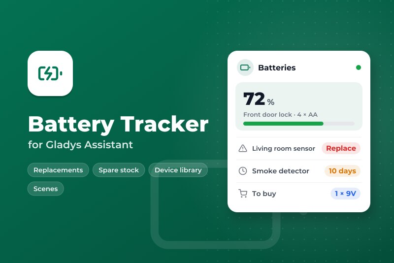
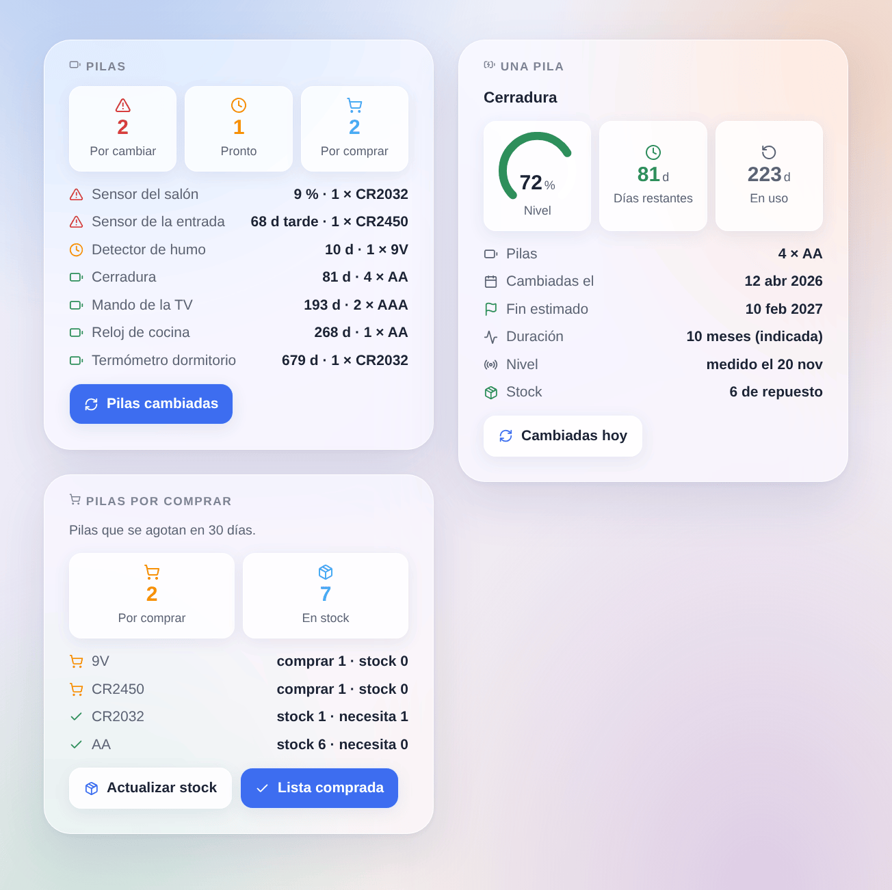
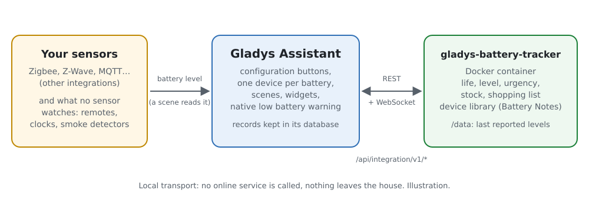
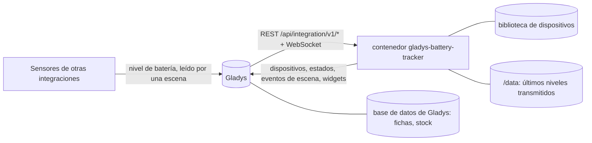
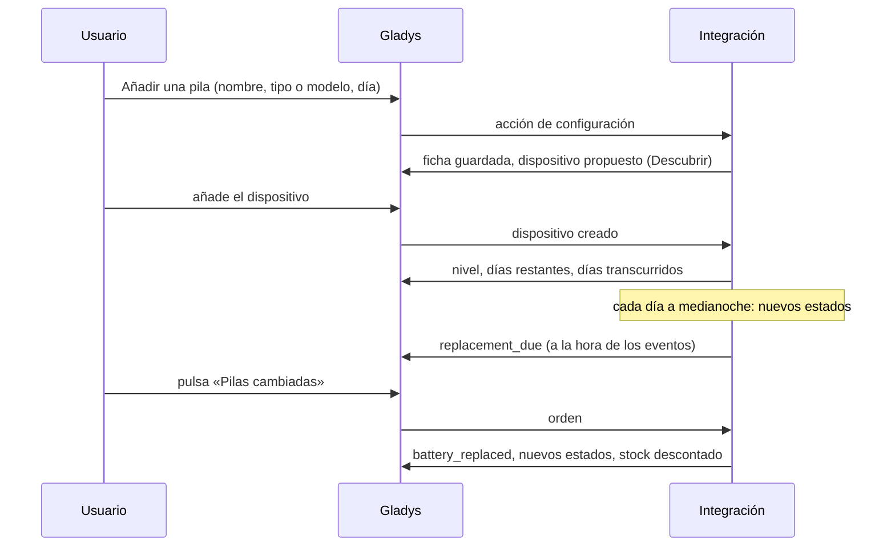

# Gladys Battery Tracker

[English](README.md) · [Français](README.fr.md) · [Deutsch](README.de.md) · **Español**

[](LICENSE)
[](https://github.com/William-De71/gladys-battery-tracker/releases)
[](https://github.com/William-De71/gladys-battery-tracker/actions/workflows/release.yml)
[](https://gladysassistant.com)



Integración externa de [Gladys Assistant](https://gladysassistant.com) que lleva el seguimiento de las pilas de la casa, en el espíritu de la integración de Home Assistant [Battery Notes](https://github.com/andrew-codechimp/HA-Battery-Notes): tipo y número de pilas de cada aparato, cambios, fin estimado, stock de repuesto y lista de compra. Todo se queda en Gladys: ningún servicio en línea, ninguna cuenta.

Documentación de usuario: [English](docs/en.md) · [Français](docs/fr.md) · [Deutsch](docs/de.md) · [Español](docs/es.md).

## Funciones

- **Un dispositivo por ficha de pilas**, añadido desde la pantalla Descubrir: nivel, días hasta el cambio, días desde el último, un pulsador «Pilas cambiadas», el día del último cambio. El nivel es una función de batería: el aviso nativo de batería baja de Gladys cubre también los mandos, relojes y detectores de humo que ningún sensor vigila.
- **Biblioteca de dispositivos**: unos 2.400 modelos con su tipo y número de pilas (de Battery Notes, MIT), para rellenar una ficha a partir del fabricante y del modelo.
- **Duración**: indicada por pila, si no aprendida de sus cambios, si no una duración por defecto; nivel estimado según la edad.
- **Niveles reales** transmitidos por una escena (una integración externa no puede leer los dispositivos de las demás integraciones): nivel bajo → por cambiar, subida de 25 puntos → cambio.
- **Stock de repuesto y lista de compra**: los cambios toman sus pilas del stock, anular las devuelve.
- **Disparadores de escena**: cambio previsto, pilas cambiadas, pilas por comprar. **Acciones de escena**: transmitir un nivel, registrar un cambio, obtener el informe de pilas.
- **Widgets de panel**: todas las pilas, una pila, las pilas por comprar.
- Inglés, francés, alemán y español en todas partes.



## Funcionamiento





De una ficha a un cambio:



### Transporte

`transports: ["local"]`: la integración no llama a ningún servicio de red. Las fichas y el stock se guardan en la configuración de Gladys (por tanto en sus copias de seguridad), los últimos niveles transmitidos en `/data`.

## Dispositivos y funciones

| Función              | Categoría / tipo   | Significado                                               |
| -------------------- | ------------------ | --------------------------------------------------------- |
| Nivel de las pilas   | `battery/integer`  | Nivel transmitido (menos de 14 días), si no estimación, % |
| Días hasta el cambio | `duration/integer` | Hasta el fin estimado, negativo una vez pasado            |
| Días desde el cambio | `duration/integer` | Desde el último cambio                                    |
| Pilas cambiadas      | `button/push`      | Registra un cambio hoy                                    |
| Último cambio        | `text/text`        | Día del último cambio                                     |

## Disparadores, acciones de escena y widgets

| Tipo       | Clave              | Caso de uso                                                                     |
| ---------- | ------------------ | ------------------------------------------------------------------------------- |
| Disparador | `replacement_due`  | Recibir un mensaje cuando una pila se acerca a su fin o transmite un nivel bajo |
| Disparador | `battery_replaced` | Lanzar la prueba de un detector de humo tras un cambio                          |
| Disparador | `stock_short`      | Añadir las pilas por comprar a una lista de la compra                           |
| Acción     | `report_level`     | Transmitir el nivel de un sensor Zigbee o Z-Wave leído por una escena           |
| Acción     | `mark_replaced`    | Registrar un cambio desde una escena (un botón físico, por ejemplo)             |
| Acción     | `get_report`       | El texto de una notificación semanal: pilas por cambiar, lista de compra        |
| Widget     | `batteries`        | Todas las pilas desde la más urgente, contadores, formulario «Pilas cambiadas»  |
| Widget     | `battery`          | Una pila: nivel, días, tipo, fechas, duración, stock                            |
| Widget     | `shopping`         | Pilas por comprar por tipo, stock, «Actualizar stock» y «Lista comprada»        |

Ejemplos: _cambio previsto_ → mensaje «Detector de humo: 1 × 9V»; cada sábado → _obtener el informe de pilas_ (lista de compra) → enviarlo antes de ir a comprar; _el nivel de batería de un sensor cambia_ → _transmitir un nivel de pila_ con `{{triggerEvent.last_value}}`. Una acción de escena nunca dispara un evento, y `replacement_due` / `stock_short` solo salen una vez por transición: una escena que reacciona a ellos no puede entrar en bucle.

## Requisitos previos

- Gladys Assistant 5.3.0 o posterior (formularios de widget, escenas, palabras clave del catálogo); las instancias más antiguas no pueden instalar la integración.
- Nada más: ni cuenta, ni hardware.

## Instalación

- **Desde la tienda**: Integraciones → Battery Tracker → Instalar.
- **Desde la URL del repositorio**: Integraciones → integración externa → `https://github.com/William-De71/gladys-battery-tracker`.
- **Modo desarrollador**: ejecute `npm start` con las variables dadas por Gladys (vea Desarrollo).

## Configuración

| Campo                                  | Por defecto | Significado                                              |
| -------------------------------------- | ----------- | -------------------------------------------------------- |
| Idioma de los textos                   | Automático  | Nombres de funciones, textos de escena, mensajes         |
| Duración por defecto (meses)           | 12          | Sin duración propia ni aprendida                         |
| Avisar antes del fin (días)            | 14          | «Por cambiar pronto» este número de días antes del fin   |
| Nivel medido bajo (%)                  | 20          | Un nivel transmitido igual o inferior obliga a cambiarla |
| Detectar los cambios por el nivel      | sí          | Una subida de 25 puntos o más es un cambio               |
| Tomar los cambios del stock            | sí          | Cuando el tipo está en stock                             |
| Horizonte de la lista de compra (días) | 30          | Pilas que se agotan en este número de días               |
| Hora de los eventos de escena          | 9           | `replacement_due` y `stock_short` la esperan             |

Botones de configuración: añadir, registrar un cambio, actualizar el stock, listar, modificar, anular el último cambio, eliminar, buscar las pilas de un modelo.

## Uso

1. Elija el idioma de los textos y luego **Añadir una pila** para cada aparato (tipo escrito, o encontrado a partir del fabricante y del modelo).
2. Añada los dispositivos desde la pestaña **Descubrir**.
3. Añada los widgets a un panel; cree escenas con los disparadores y las acciones, y transmita el nivel real de sus sensores con `report_level`.

## Desarrollo

```bash
npm install
npm test                       # node --test, nunca toca la red
npm run lint                   # ESLint
npm run format:check           # Prettier
npx github:GladysAssistant/integration-store . --skip-image-check
scripts/build-cover.sh         # cover.jpg a partir de docs/assets/cover.svg
docs/illustrations/render.sh   # docs/assets/widgets.<lang>.png
node scripts/update-library.mjs  # actualiza src/data/library.json desde Battery Notes
```

En local, el SDK lee `GLADYS_HOST_API_URL`, `GLADYS_INTEGRATION_TOKEN` y `GLADYS_INTEGRATION_SELECTOR` (dados por Gladys en modo desarrollador). `DEBUG=gladys-integration-sdk` muestra los registros del SDK.

Las pruebas cubren el cálculo de días, la duración (indicada, aprendida, por defecto), los niveles y urgencias, la lista de compra, los formularios del registro y la biblioteca de dispositivos, los dispositivos (límites e indicadores de cada función, pares categoría/tipo), los widgets (`validateWidgetContent`), el manifiesto, los cuatro idiomas, el script de release y toda la integración frente al Gladys falso del SDK. `test/structure.test.js` congela cada clave guardada por los usuarios y las funciones de los dispositivos.

## Proceso de release


Cada fusión en `main` lanza la CI y luego calcula la versión a partir de los [Conventional Commits](https://www.conventionalcommits.org/es/) desde la última etiqueta: `feat` → minor, `fix` / `perf` → parche, `!` o `BREAKING CHANGE` → major (un minor por debajo de 1.0.0); `docs`, `chore`, `ci`, `test`, `style`, `refactor`, `build` solos no publican nada. Se genera la sección del changelog, se sube la etiqueta, se construye la imagen multiarquitectura, luego `main` recibe el commit de release, se crea la GitHub Release y un último job comprueba la imagen pública, el validador de la tienda y el topic.

- El título de la pull request se convierte en el commit squash y luego en la línea del changelog: escríbalo en inglés, para el usuario (`pr-title.yml` lo comprueba). Nunca edite `CHANGELOG.md` a mano.
- La 1.0.0 es una decisión: Actions → Release → Run workflow con `release-as: 1.0.0`. `dry-run` muestra la versión y las notas sin publicar.
- **Rama protegida**: la release sube su commit a `main` con `GITHUB_TOKEN`. Con un ruleset más estricto en `main` (pull request o checks obligatorios), añada GitHub Actions a su lista de omisión (o suba mediante una GitHub App); si no, el job de publicación falla con instrucciones.
- Tras la primera release, haga público el paquete de `ghcr.io` (Package settings → Change visibility); si no, Gladys no puede descargarlo.

## Solución de problemas

Vea [docs/es.md](docs/es.md#solución-de-problemas). Informe de los problemas con las versiones de Gladys y de la integración y los registros de la integración (`DEBUG=gladys-integration-sdk`).

## Contribuir

Las issues y pull requests son bienvenidas, también los modelos que faltan en la biblioteca (pertenecen a [la biblioteca de Battery Notes](https://github.com/andrew-codechimp/HA-Battery-Notes), actualizada aquí con `scripts/update-library.mjs`). Ejecute `npm run format:check && npm run lint && npm test` antes de abrir una pull request y mantenga sin cambios cada clave guardada (vea [CLAUDE.md](CLAUDE.md)).

## Seguridad

Vea [SECURITY.md](SECURITY.md): informe de las vulnerabilidades en privado. La integración no tiene ningún secreto y no llama a ningún servicio de red; solo escribe sus fichas (configuración de Gladys) y `/data`.

## Capturas por venir

Las imágenes de arriba son ilustraciones, no capturas de pantalla. Las capturas reales irán en `docs/assets/screenshots/` (PNG, 1280 × 800): `configuration.png` (los botones), `discovery.png`, `device.png` (una pila en un panel), `scene-report-level.png`.

## Licencia

[Licencia Apache 2.0](LICENSE) — vea también [NOTICE](NOTICE). La biblioteca de dispositivos procede de [Battery Notes](https://github.com/andrew-codechimp/HA-Battery-Notes) (licencia MIT, Copyright (c) 2023-2026 Andrew Jackson, vea `src/data/LICENSE.battery-notes`); esta integración no está afiliada a ella. Gracias a la documentación y al SDK de Gladys.
