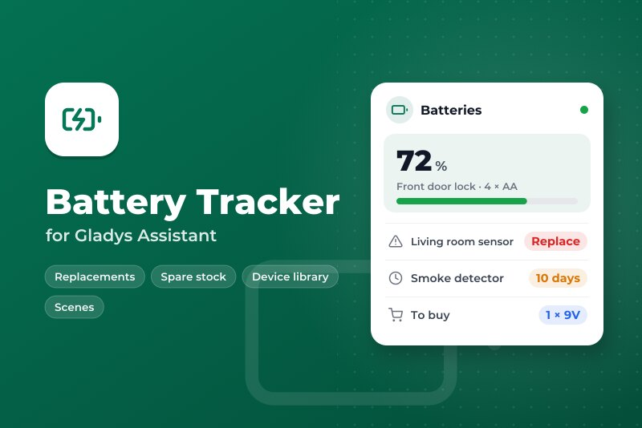
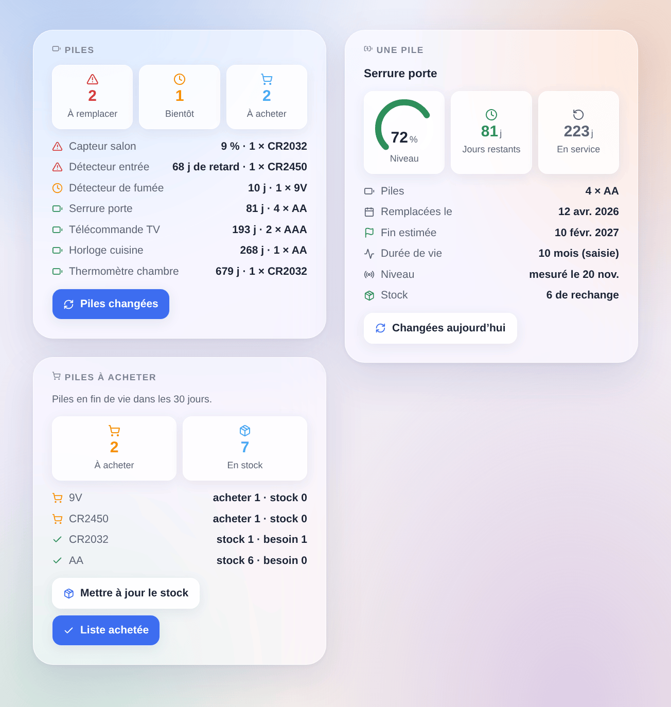
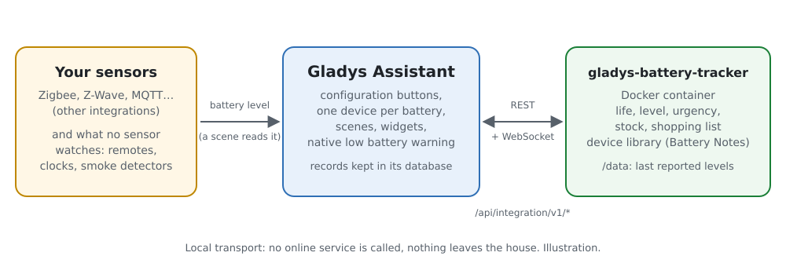
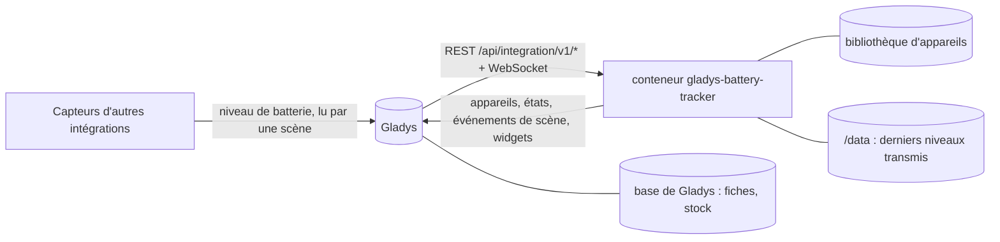
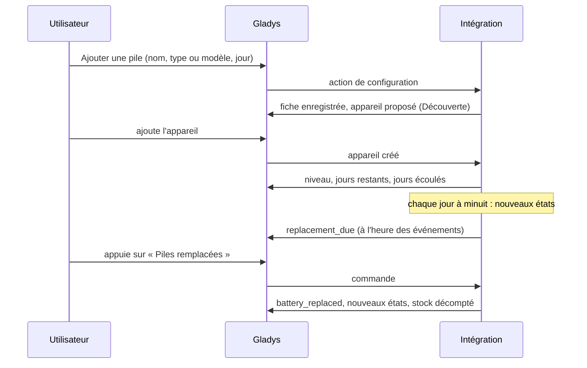

# Gladys Battery Tracker

[English](README.md) · **Français** · [Deutsch](README.de.md) · [Español](README.es.md)

[](LICENSE)
[](https://github.com/William-De71/gladys-battery-tracker/releases)
[](https://github.com/William-De71/gladys-battery-tracker/actions/workflows/release.yml)
[](https://gladysassistant.com)



Intégration externe de [Gladys Assistant](https://gladysassistant.com) qui tient le suivi des piles de la maison, dans l'esprit de l'intégration Home Assistant [Battery Notes](https://github.com/andrew-codechimp/HA-Battery-Notes) : type et nombre de piles de chaque appareil, remplacements, fin estimée, stock de rechange et liste d'achats. Tout reste dans Gladys : aucun service en ligne, aucun compte.

Documentation utilisateur : [English](docs/en.md) · [Français](docs/fr.md) · [Deutsch](docs/de.md) · [Español](docs/es.md).

## Fonctionnalités

- **Un appareil par fiche de piles**, ajouté depuis l'écran Découverte : niveau, jours avant le remplacement, jours depuis le dernier, un bouton poussoir « Piles remplacées », le jour du dernier remplacement. Le niveau est une fonctionnalité de batterie : l'alerte native de batterie faible de Gladys couvre aussi les télécommandes, horloges et détecteurs de fumée qu'aucun capteur ne surveille.
- **Bibliothèque d'appareils** : environ 2 400 modèles avec leur type et nombre de piles (issue de Battery Notes, MIT), pour remplir une fiche d'après le fabricant et le modèle.
- **Durée de vie** : saisie par pile, sinon apprise de ses remplacements, sinon une durée par défaut ; niveau estimé d'après l'âge.
- **Vrais niveaux** transmis par une scène (une intégration externe ne peut pas lire les appareils des autres intégrations) : niveau bas → à remplacer, remontée de 25 points → remplacement.
- **Stock de rechange et liste d'achats** : les remplacements prennent leurs piles dans le stock, l'annulation les rend.
- **Déclencheurs de scène** : remplacement à prévoir, piles remplacées, piles à acheter. **Actions de scène** : transmettre un niveau, enregistrer un remplacement, obtenir le bilan des piles.
- **Widgets de tableau de bord** : toutes les piles, une pile, les piles à acheter.
- Anglais, français, allemand et espagnol partout.



## Fonctionnement





D'une fiche à un remplacement :



### Transport

`transports: ["local"]` : l'intégration n'appelle aucun service réseau. Les fiches et le stock sont stockés dans la configuration de Gladys (donc dans ses sauvegardes), les derniers niveaux transmis dans `/data`.

## Appareils et fonctionnalités

| Fonctionnalité               | Catégorie / type   | Rôle                                                     |
| ---------------------------- | ------------------ | -------------------------------------------------------- |
| Niveau des piles             | `battery/integer`  | Niveau transmis (moins de 14 jours), sinon estimation, % |
| Jours avant remplacement     | `duration/integer` | Jusqu'à la fin estimée, négatif une fois dépassée        |
| Jours depuis le remplacement | `duration/integer` | Depuis le dernier remplacement                           |
| Piles remplacées             | `button/push`      | Enregistre un remplacement aujourd'hui                   |
| Dernier remplacement         | `text/text`        | Jour du dernier remplacement                             |

## Déclencheurs, actions de scène et widgets

| Type        | Clé                | Cas d'usage                                                                      |
| ----------- | ------------------ | -------------------------------------------------------------------------------- |
| Déclencheur | `replacement_due`  | Recevoir un message quand une pile approche de sa fin ou transmet un niveau bas  |
| Déclencheur | `battery_replaced` | Lancer le test d'un détecteur de fumée après un remplacement                     |
| Déclencheur | `stock_short`      | Ajouter les piles à acheter à une liste de courses                               |
| Action      | `report_level`     | Transmettre le niveau d'un capteur Zigbee ou Z-Wave lu par une scène             |
| Action      | `mark_replaced`    | Enregistrer un remplacement depuis une scène (un bouton physique, par exemple)   |
| Action      | `get_report`       | Le texte d'une notification hebdomadaire : piles à remplacer, liste d'achats     |
| Widget      | `batteries`        | Toutes les piles de la plus urgente, compteurs, formulaire « Piles changées »    |
| Widget      | `battery`          | Une pile : niveau, jours, type, dates, durée de vie, stock                       |
| Widget      | `shopping`         | Piles à acheter par type, stock, « Mettre à jour le stock » et « Liste achetée » |

Exemples : _remplacement à prévoir_ → message « Détecteur de fumée : 1 × 9V » ; chaque samedi → _obtenir le bilan des piles_ (liste d'achats) → l'envoyer avant les courses ; _la batterie d'un capteur change_ → _transmettre un niveau de pile_ avec `{{triggerEvent.last_value}}`. Une action de scène ne déclenche jamais d'événement, et `replacement_due` / `stock_short` ne partent qu'une fois par transition : une scène qui y réagit ne peut pas boucler.

## Prérequis

- Gladys Assistant 5.3.0 ou plus récent (formulaires de widget, scènes, mots-clés du catalogue) ; les instances plus anciennes ne peuvent pas installer l'intégration.
- Rien d'autre : ni compte, ni matériel.

## Installation

- **Depuis le store** : Intégrations → Battery Tracker → Installer.
- **Depuis l'URL du dépôt** : Intégrations → intégration externe → `https://github.com/William-De71/gladys-battery-tracker`.
- **Mode développeur** : lancez `npm start` avec les variables données par Gladys (voir Développement).

## Configuration

| Champ                                    | Défaut      | Rôle                                                          |
| ---------------------------------------- | ----------- | ------------------------------------------------------------- |
| Langue des textes                        | Automatique | Noms des fonctionnalités, textes des scènes, messages         |
| Durée de vie par défaut (mois)           | 12          | Sans durée propre ni durée apprise                            |
| Prévenir avant la fin (jours)            | 14          | « À remplacer bientôt » ce nombre de jours avant la fin       |
| Niveau mesuré bas (%)                    | 20          | Un niveau transmis inférieur ou égal rend la pile à remplacer |
| Détecter les remplacements par le niveau | oui         | Une remontée de 25 points ou plus est un remplacement         |
| Prendre les remplacements dans le stock  | oui         | Quand le type est en stock                                    |
| Horizon de la liste d'achats (jours)     | 30          | Piles en fin de vie dans ce nombre de jours                   |
| Heure des événements de scène            | 9           | `replacement_due` et `stock_short` l'attendent                |

Boutons de configuration : ajouter, enregistrer un remplacement, mettre à jour le stock, lister, modifier, annuler le dernier remplacement, supprimer, trouver les piles d'un modèle.

## Utilisation

1. Choisissez la langue des textes, puis **Ajouter une pile** pour chaque appareil (type saisi, ou trouvé d'après le fabricant et le modèle).
2. Ajoutez les appareils depuis l'onglet **Découverte**.
3. Ajoutez les widgets à un tableau de bord ; créez des scènes avec les déclencheurs et les actions, et transmettez le vrai niveau de vos capteurs avec `report_level`.

## Développement

```bash
npm install
npm test                       # node --test, ne touche jamais le réseau
npm run lint                   # ESLint
npm run format:check           # Prettier
npx github:GladysAssistant/integration-store . --skip-image-check
scripts/build-cover.sh         # cover.jpg depuis docs/assets/cover.svg
docs/illustrations/render.sh   # docs/assets/widgets.<lang>.png
node scripts/update-library.mjs  # rafraîchit src/data/library.json depuis Battery Notes
```

En local, le SDK lit `GLADYS_HOST_API_URL`, `GLADYS_INTEGRATION_TOKEN` et `GLADYS_INTEGRATION_SELECTOR` (donnés par Gladys en mode développeur). `DEBUG=gladys-integration-sdk` affiche les journaux du SDK.

Les tests couvrent le calcul des jours, la durée de vie (saisie, apprise, par défaut), les niveaux et urgences, la liste d'achats, les formulaires du registre et la bibliothèque d'appareils, les appareils (bornes et drapeaux de chaque fonctionnalité, couples catégorie/type), les widgets (`validateWidgetContent`), le manifeste, les quatre langues, le script de release, et toute l'intégration face au faux Gladys du SDK. `test/structure.test.js` fige chaque clé stockée par les utilisateurs et les fonctionnalités des appareils.

## Processus de release


Chaque fusion sur `main` lance la CI, puis calcule la version d'après les [Conventional Commits](https://www.conventionalcommits.org/fr/) depuis le dernier tag : `feat` → mineure, `fix` / `perf` → correctif, `!` ou `BREAKING CHANGE` → majeure (une mineure sous 1.0.0) ; `docs`, `chore`, `ci`, `test`, `style`, `refactor`, `build` seuls ne publient rien. La section du changelog est générée, le tag poussé, l'image multi-architecture construite, puis `main` reçoit le commit de release, la GitHub Release est créée et un dernier job vérifie l'image publique, le validateur du store et le topic.

- Le titre de la pull request devient le commit squash, puis la ligne du changelog : écrivez-le en anglais, pour l'utilisateur (`pr-title.yml` le vérifie). Ne modifiez jamais `CHANGELOG.md` à la main.
- La 1.0.0 est une décision : Actions → Release → Run workflow avec `release-as: 1.0.0`. `dry-run` affiche la version et les notes sans publier.
- **Branche protégée** : la release pousse son commit sur `main` avec `GITHUB_TOKEN`. Avec un ruleset plus strict sur `main` (pull request ou checks obligatoires), ajoutez GitHub Actions à sa liste de contournement (ou poussez via une GitHub App), sinon le job de publication échoue avec les instructions.
- Après la première release, rendez le package `ghcr.io` public (Package settings → Change visibility), sinon Gladys ne peut pas le télécharger.

## Dépannage

Voir [docs/fr.md](docs/fr.md#dépannage). Signalez un problème avec les versions de Gladys et de l'intégration et les journaux de l'intégration (`DEBUG=gladys-integration-sdk`).

## Contribuer

Les issues et pull requests sont les bienvenues, les modèles absents de la bibliothèque aussi (ils relèvent de [la bibliothèque de Battery Notes](https://github.com/andrew-codechimp/HA-Battery-Notes), rafraîchie ici par `scripts/update-library.mjs`). Lancez `npm run format:check && npm run lint && npm test` avant d'ouvrir une pull request, et gardez chaque clé stockée inchangée (voir [CLAUDE.md](CLAUDE.md)).

## Sécurité

Voir [SECURITY.md](SECURITY.md) : signalez les vulnérabilités en privé. L'intégration n'a aucun secret et n'appelle aucun service réseau ; elle n'écrit que ses fiches (configuration de Gladys) et `/data`.

## Captures à venir

Les images ci-dessus sont des illustrations, pas des captures d'écran. Les vraies captures iront dans `docs/assets/screenshots/` (PNG, 1280 × 800) : `configuration.png` (les boutons), `discovery.png`, `device.png` (une pile sur un tableau de bord), `scene-report-level.png`.

## Licence

[Licence Apache 2.0](LICENSE) — voir aussi [NOTICE](NOTICE). La bibliothèque d'appareils vient de [Battery Notes](https://github.com/andrew-codechimp/HA-Battery-Notes) (licence MIT, Copyright (c) 2023-2026 Andrew Jackson, voir `src/data/LICENSE.battery-notes`) ; cette intégration n'y est pas affiliée. Merci à la documentation et au SDK de Gladys.
