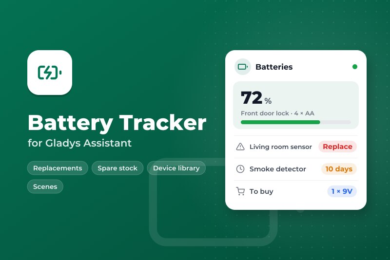
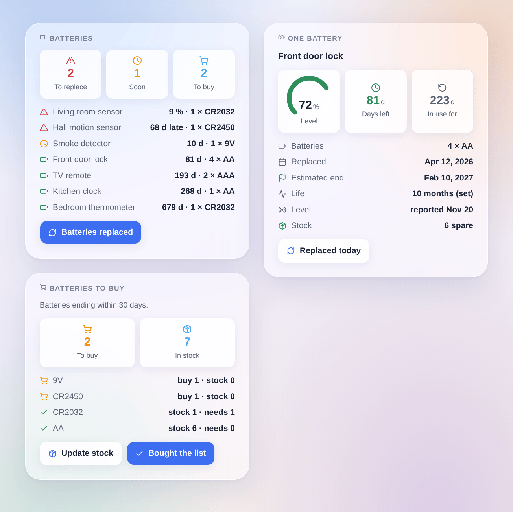
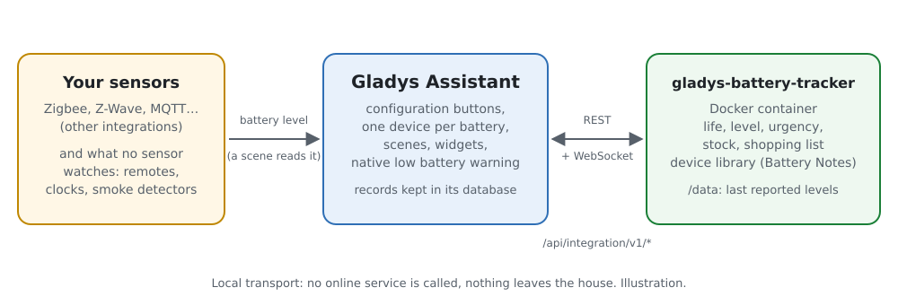
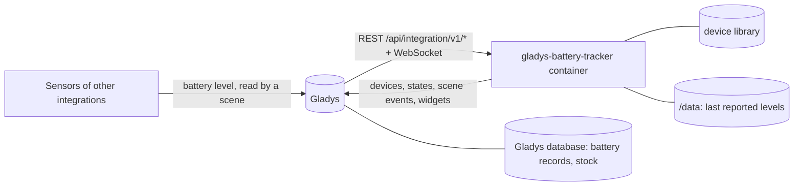
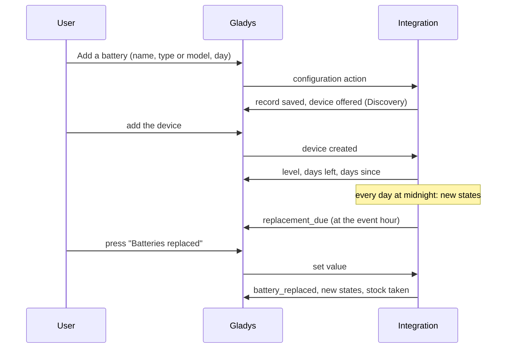

# Gladys Battery Tracker

**English** · [Français](README.fr.md) · [Deutsch](README.de.md) · [Español](README.es.md)

[](LICENSE)
[](https://github.com/William-De71/gladys-battery-tracker/releases)
[](https://github.com/William-De71/gladys-battery-tracker/actions/workflows/release.yml)
[](https://gladysassistant.com)



[Gladys Assistant](https://gladysassistant.com) external integration that keeps track of the batteries of the house, in the spirit of the Home Assistant integration [Battery Notes](https://github.com/andrew-codechimp/HA-Battery-Notes): battery type and count of each device, replacements, estimated end, spare stock and shopping list. Everything stays in Gladys: no online service, no account.

User documentation: [English](docs/en.md) · [Français](docs/fr.md) · [Deutsch](docs/de.md) · [Español](docs/es.md).

## Features

- **One device per battery record**, added from the Discovery screen: level, days until the replacement, days since the last one, a "Batteries replaced" push button, the day of the last replacement. The level is a battery feature: the native low battery warning of Gladys also covers remotes, clocks and smoke detectors no sensor watches.
- **Device library**: about 2,400 models with their battery type and count (from Battery Notes, MIT), to fill a record from the manufacturer and the model.
- **Life**: typed per battery, else learned from its replacements, else a default life; level estimated from the age.
- **Real levels** reported by a scene (an external integration cannot read the other integrations' devices): low level → due, rise of 25 points → replacement.
- **Spare stock and shopping list**: replacements take their batteries from the stock, undo gives them back.
- **Scene triggers**: replacement due, batteries replaced, batteries to buy. **Scene actions**: report a level, record a replacement, get the battery report.
- **Dashboard widgets**: every battery, one battery, the batteries to buy.
- English, French, German and Spanish everywhere.



## How it works





From a record to a replacement:



### Transport

`transports: ["local"]`: the integration calls no network service. The records and the stock are stored in the Gladys configuration (so in its backups), the last reported levels in `/data`.

## Devices and features

| Feature                | Category / type    | Meaning                                                  |
| ---------------------- | ------------------ | -------------------------------------------------------- |
| Battery level          | `battery/integer`  | Reported level (less than 14 days old), else estimate, % |
| Days until replacement | `duration/integer` | Until the estimated end, negative once passed            |
| Days since replacement | `duration/integer` | Since the last replacement                               |
| Batteries replaced     | `button/push`      | Records a replacement today                              |
| Last replacement       | `text/text`        | Day of the last replacement                              |

## Scene triggers, actions and widgets

| Kind    | Key                | Use case                                                                |
| ------- | ------------------ | ----------------------------------------------------------------------- |
| Trigger | `replacement_due`  | Get a message when a battery nears its end or reports a low level       |
| Trigger | `battery_replaced` | Run the test of a smoke detector after a replacement                    |
| Trigger | `stock_short`      | Add the batteries to buy to a shopping list                             |
| Action  | `report_level`     | Pass the level of a Zigbee or Z-Wave sensor read by a scene             |
| Action  | `mark_replaced`    | Record a replacement from a scene (a physical button, for example)      |
| Action  | `get_report`       | The text of a weekly notification: batteries to replace, shopping list  |
| Widget  | `batteries`        | Every battery from the most urgent, counters, "Batteries replaced" form |
| Widget  | `battery`          | One battery: level, days, type, dates, life, stock                      |
| Widget  | `shopping`         | Batteries to buy per type, stock, "Update stock" and "Bought the list"  |

Examples: _replacement due_ → message "Smoke detector: 1 × 9V"; every Saturday → _get the battery report_ (shopping list) → send it before going shopping; _battery level of a sensor changes_ → _report a battery level_ with `{{triggerEvent.last_value}}`. A scene action never fires a trigger, and `replacement_due` / `stock_short` fire once per transition: a scene reacting to them cannot loop.

## Requirements

- Gladys Assistant 5.3.0 or later (widget forms, scenes, catalog keywords); older instances cannot install the integration.
- Nothing else: no account, no hardware.

## Installation

- **From the store**: Integrations → Battery Tracker → Install.
- **From the repository URL**: Integrations → external integration → `https://github.com/William-De71/gladys-battery-tracker`.
- **Developer mode**: run `npm start` with the variables given by Gladys (see Development).

## Configuration

| Field                              | Default   | Meaning                                               |
| ---------------------------------- | --------- | ----------------------------------------------------- |
| Language of the texts              | Automatic | Feature names, scene texts, messages of the buttons   |
| Default life (months)              | 12        | Without a life of its own nor a learned one           |
| Warn before the end (days)         | 14        | "To replace soon" this many days before the end       |
| Low reported level (%)             | 20        | A reported level at or under it makes the battery due |
| Detect replacements from the level | yes       | A rise of 25 points or more is a replacement          |
| Take replacements from the stock   | yes       | When the type is in stock                             |
| Shopping list horizon (days)       | 30        | Batteries ending within this many days                |
| Hour of the scene events           | 9         | `replacement_due` and `stock_short` wait for it       |

Configuration buttons: add, record a replacement, update the stock, list, edit, undo the last replacement, remove, find the batteries of a model.

## Usage

1. Choose the language of the texts, then **Add a battery** for each device (type typed, or found from the manufacturer and model).
2. Add the devices from the **Discover** tab.
3. Add the widgets to a dashboard; build scenes with the triggers and actions, and report the real level of your sensors with `report_level`.

## Development

```bash
npm install
npm test                       # node --test, never touches the network
npm run lint                   # ESLint
npm run format:check           # Prettier
npx github:GladysAssistant/integration-store . --skip-image-check
scripts/build-cover.sh         # cover.jpg from docs/assets/cover.svg
docs/illustrations/render.sh   # docs/assets/widgets.<lang>.png
node scripts/update-library.mjs  # refresh src/data/library.json from Battery Notes
```

Locally, the SDK reads `GLADYS_HOST_API_URL`, `GLADYS_INTEGRATION_TOKEN` and `GLADYS_INTEGRATION_SELECTOR` (given by Gladys in developer mode). `DEBUG=gladys-integration-sdk` shows the SDK logs.

The tests cover the day arithmetic, the life (typed, learned, default), the levels and urgencies, the shopping list, the forms of the registry and the device library, the devices (ranges and flags of every feature, category/type pairs), the widgets (`validateWidgetContent`), the manifest, the four languages, the release script, and the whole integration against the fake Gladys of the SDK. `test/structure.test.js` freezes every key users store and the features of the devices.

## Release process


Every merge on `main` runs the CI, then computes the version from the [Conventional Commits](https://www.conventionalcommits.org/) since the last tag: `feat` → minor, `fix` / `perf` → patch, `!` or `BREAKING CHANGE` → major (a minor below 1.0.0); `docs`, `chore`, `ci`, `test`, `style`, `refactor`, `build` alone publish nothing. The changelog section is generated, the tag pushed, the multi-architecture image built, then `main` receives the release commit, the GitHub Release is created and a last job checks the public image, the store validator and the topic.

- The pull request title becomes the squash commit, then the changelog line: write it in English, for the user (`pr-title.yml` checks it). Never edit `CHANGELOG.md` by hand.
- 1.0.0 is a decision: Actions → Release → Run workflow with `release-as: 1.0.0`. `dry-run` shows the version and the notes without publishing.
- **Protected branch**: the release pushes its commit to `main` with `GITHUB_TOKEN`. With a stricter ruleset on `main` (required pull request or checks), add GitHub Actions to its bypass list (or push through a GitHub App), otherwise the publish job fails with instructions.
- After the first release, make the `ghcr.io` package public (Package settings → Change visibility), or Gladys cannot pull it.

## Troubleshooting

See [docs/en.md](docs/en.md#troubleshooting). Report issues with the versions of Gladys and of the integration and the logs of the integration (`DEBUG=gladys-integration-sdk`).

## Contributing

Issues and pull requests are welcome, models missing from the library too (they belong to [the Battery Notes library](https://github.com/andrew-codechimp/HA-Battery-Notes), refreshed here by `scripts/update-library.mjs`). Run `npm run format:check && npm run lint && npm test` before opening a pull request, and keep every stored key unchanged (see [CLAUDE.md](CLAUDE.md)).

## Security

See [SECURITY.md](SECURITY.md): report vulnerabilities privately. The integration has no secret and calls no network service; it writes only its records (Gladys configuration) and `/data`.

## Screenshots to come

The images above are illustrations, not screenshots. Real screenshots will go in `docs/assets/screenshots/` (PNG, 1280 × 800): `configuration.png` (the buttons), `discovery.png`, `device.png` (a battery on a dashboard), `scene-report-level.png`.

## License

[Apache License 2.0](LICENSE) — see also [NOTICE](NOTICE). The device library comes from [Battery Notes](https://github.com/andrew-codechimp/HA-Battery-Notes) (MIT License, Copyright (c) 2023-2026 Andrew Jackson, see `src/data/LICENSE.battery-notes`); this integration is not affiliated with it. Thanks to the Gladys documentation and SDK.
