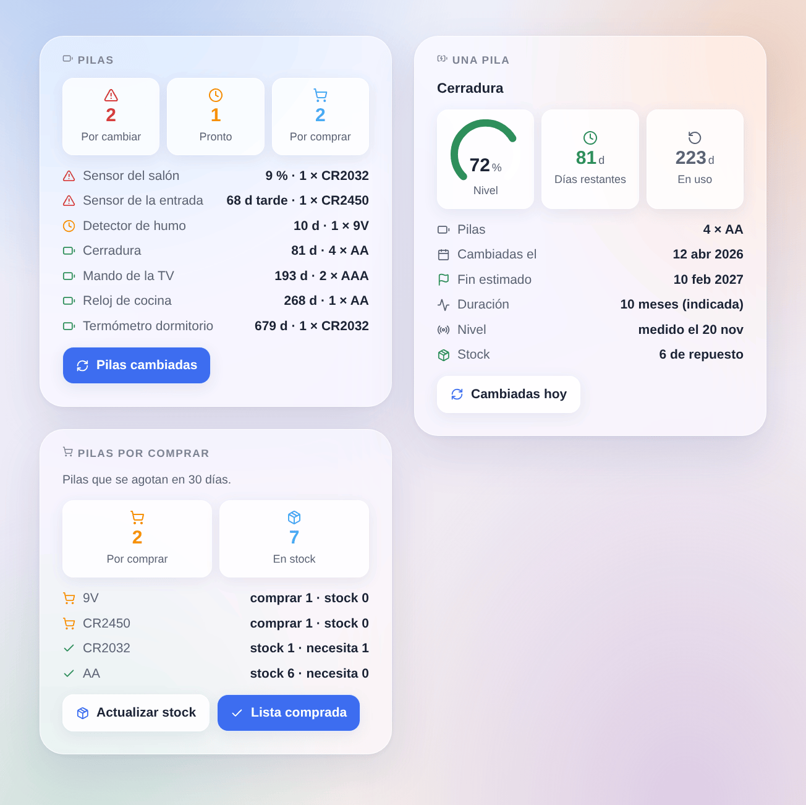

# Battery Tracker

## Presentación

Esta integración lleva el seguimiento de las pilas de su casa, en el
espíritu de la integración de Home Assistant Battery Notes: para cada aparato
con pilas, el tipo y el número de pilas, el día en que se cambiaron, su fin
estimado y sus pilas de repuesto en stock.

- **Un dispositivo por ficha de pilas**: nivel, días hasta el cambio, días
  desde el último, un botón «Pilas cambiadas» y el día del último cambio.
  Como su nivel es una función de batería, el **aviso nativo de batería baja
  de Gladys** cubre también lo que ningún sensor vigila: mandos a distancia,
  relojes, detectores de humo.
- **Biblioteca de dispositivos**: unos 2.400 modelos (Zigbee, Z-Wave,
  Bluetooth…) con su tipo y número de pilas, procedente de Battery Notes,
  para rellenar una ficha a partir del fabricante y del modelo.
- **Stock de repuesto y lista de compra**: un cambio toma sus pilas del
  stock, y la lista dice qué comprar para las pilas que se agotan pronto.
- **Escenas**: tres disparadores (cambio previsto, pilas cambiadas, pilas por
  comprar) y tres acciones (transmitir un nivel, registrar un cambio, obtener
  el informe de pilas).
- **Tres widgets de panel**: todas las pilas, una pila, las pilas por
  comprar.

Transporte: **local**. La integración no llama a ningún servicio en línea:
las fichas se quedan en la base de datos de Gladys (y en sus copias de
seguridad).

## Requisitos previos

- Gladys Assistant **5.3.0** o posterior.
- Nada más: ni cuenta, ni hardware.

Una integración externa no puede leer los dispositivos de las demás
integraciones: el nivel real de un sensor Zigbee solo llega a Battery Tracker
mediante una escena (vea «Transmitir el nivel real» más abajo). Sin ella, el
nivel se **estima** según la edad de las pilas.

## Configuración

1. En Gladys, abra **Integraciones → Battery Tracker → Configuración**.
2. Elija primero el **Idioma de los textos**: un dispositivo conserva los
   nombres de funciones con los que se crea.
3. Haga clic en **Añadir una pila** para cada aparato con pilas: un nombre
   (lo que alimentan las pilas), el tipo de pila (escrito en la pila), el
   número y el día en que se pusieron. Deje el tipo vacío e indique el
   fabricante y el modelo para buscarlos en la biblioteca.
4. Abra la pestaña **Descubrir** y añada las pilas: cada una se convierte en
   un dispositivo.

| Ajuste                                 | Por defecto | Función                                                                |
| -------------------------------------- | ----------- | ---------------------------------------------------------------------- |
| Idioma de los textos                   | Automático  | Nombres de funciones, textos de escena, mensajes de los botones        |
| Duración por defecto (meses)           | 12          | Duración de una pila sin duración propia ni aprendida                  |
| Avisar antes del fin (días)            | 14          | Una pila está «por cambiar pronto» este número de días antes de su fin |
| Nivel medido bajo (%)                  | 20          | Un nivel transmitido igual o inferior hace que la pila deba cambiarse  |
| Detectar los cambios por el nivel      | sí          | Un nivel transmitido que sube 25 puntos o más cuenta como un cambio    |
| Tomar los cambios del stock            | sí          | Cuando el tipo de la pila está en stock                                |
| Horizonte de la lista de compra (días) | 30          | La lista cubre las pilas que se agotan en este número de días          |
| Hora de los eventos de escena          | 9           | «Cambio previsto» y «Pilas por comprar» no salen antes                 |

Los demás botones: **Registrar un cambio**, **Actualizar el stock** (añadir,
quitar o fijar una cantidad por tipo), **Listar las pilas** (con sus
números), **Modificar una pila**, **Anular el último cambio** (un botón
pulsado por error), **Eliminar una pila**, **Buscar las pilas de un modelo**.
Una pila se designa por su número en la lista (`#2`) o su nombre exacto.

## Uso

### Los dispositivos

| Función              | Significado                                                             |
| -------------------- | ----------------------------------------------------------------------- |
| Nivel de las pilas   | El nivel transmitido si tiene menos de 14 días, si no la estimación (%) |
| Días hasta el cambio | Hasta el fin estimado, negativo una vez pasado                          |
| Días desde el cambio | Desde el último cambio                                                  |
| Pilas cambiadas      | Pulsador: registra un cambio hoy                                        |
| Último cambio        | El día del último cambio                                                |

**Duración**: la duración indicada en la pila, si no la duración
**aprendida** de sus cambios (media de los tres últimos intervalos), si no la
duración por defecto. El nivel estimado baja linealmente durante la
duración: indica la edad de las pilas, no su química.

Gladys ya avisa a los administradores cada sábado a las 9:00 cuando un nivel
de batería baja del umbral de **Ajustes → Sistema**: una pila estimada baja
aparece en él, un sensor que transmite su propio nivel también (su ficha aquí
cuenta entonces dos veces).

### Transmitir el nivel real

Para un sensor que da su nivel de batería, cree una escena:

1. Disparador: **la batería del sensor cambia** (disparador de dispositivo,
   cualquier cambio).
2. Acción: **Transmitir un nivel de pila** (Battery Tracker), pila = su
   dispositivo aquí, nivel = el valor del disparador, por ejemplo
   `{{triggerEvent.last_value}}`.

El nivel sustituye entonces a la estimación; igual o inferior al nivel bajo,
la pila debe cambiarse. Una subida de 25 puntos o más cuenta como un cambio
(el disparador «Pilas cambiadas» no sale en ese caso: una acción de escena
nunca dispara un evento).

### Stock y lista de compra

Anote sus pilas de repuesto con **Actualizar el stock** o el widget. Cada
cambio toma sus pilas del stock de su tipo; **Anular el último cambio** las
devuelve. La lista de compra cuenta, por tipo, las pilas que se agotan en el
horizonte menos el stock; «Lista comprada» lo añade todo al stock de una vez.

### Escenas

- Disparadores: **Cambio de pilas previsto** (una vez por pila, filtro por
  pila y motivo), **Pilas cambiadas** (botón del dispositivo, widget o
  configuración), **Pilas por comprar** (una vez por tipo hasta reponer).
- Acciones: **Transmitir un nivel de pila**, **Registrar un cambio de
  pilas**, **Obtener el informe de pilas** (un texto: pilas por cambiar,
  todas, o la lista de compra).

Ejemplos:

- _Cambio previsto_ → enviar `{{triggerEvent.data.name}}: {{triggerEvent.data.quantity}} × {{triggerEvent.data.battery_type}}` a su teléfono.
- Cada sábado a las 10:00 → **Obtener el informe de pilas** (lista de
  compra) → enviar su texto en un mensaje antes de ir a comprar.
- _Pilas cambiadas_ en el detector de humo → lanzar su prueba mediante su
  propia integración.

### Widgets

- **Pilas**: contadores (por cambiar, pronto, por comprar), una fila por
  pila desde la más urgente, un botón «Pilas cambiadas» con formulario (qué
  pila, qué día).
- **Una pila**: indicador del nivel, días restantes y en uso, tipo, fechas,
  duración (indicada, aprendida o por defecto), stock, botón «Cambiadas hoy».
- **Pilas por comprar**: qué comprar por tipo, el stock, botones «Actualizar
  stock» y «Lista comprada».

## Solución de problemas

- **El dispositivo no aparece**: abra la pestaña Descubrir tras añadir la
  pila; una pila eliminada requiere también eliminar su dispositivo en
  Gladys.
- **Los nombres de las funciones están en el idioma equivocado**: Gladys
  nunca renombra las funciones de un dispositivo creado. Cambie el idioma,
  elimine el dispositivo y vuelva a añadirlo desde la pestaña Descubrir.
- **«Transmitir un nivel de pila» falla**: el nivel debe ser un número de 0 a
  100; compruebe la variable de la escena (`{{…}}`) en los registros de la
  escena.
- **Un cambio registrado por error**: **Anular el último cambio**.
- **La biblioteca encuentra varios modelos**: indique el modelo exacto o su
  referencia, o escriba el tipo de pila usted mismo.
- **Registros**: Integraciones → Battery Tracker → Registros, con
  `DEBUG=gladys-integration-sdk` para el detalle del SDK. Informe de un
  problema en
  [GitHub](https://github.com/William-De71/gladys-battery-tracker/issues)
  con las versiones de Gladys y de la integración.
