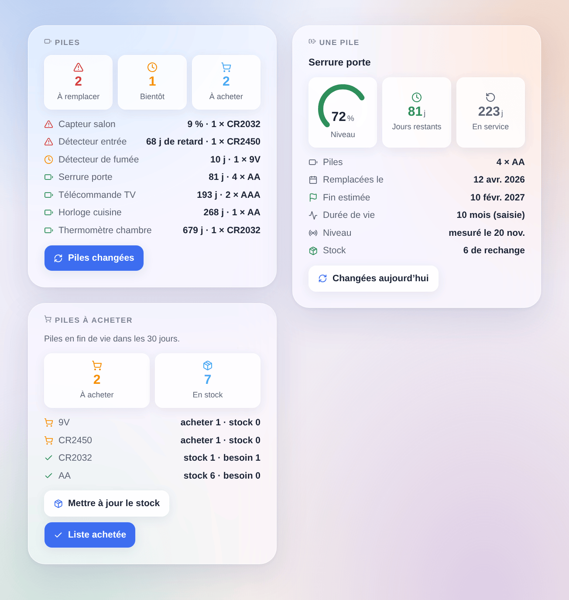

# Suivi des piles (Battery Tracker)

## Présentation

Cette intégration tient le suivi des piles de la maison, dans l'esprit de
l'intégration Home Assistant Battery Notes : pour chaque appareil à piles, le
type et le nombre de piles, le jour où elles ont été changées, leur fin
estimée, et vos piles de rechange en stock.

- **Un appareil par fiche de piles** : niveau, jours avant le remplacement,
  jours depuis le dernier, un bouton « Piles remplacées » et le jour du
  dernier remplacement. Son niveau étant une fonctionnalité de batterie,
  l'**alerte native de batterie faible de Gladys** couvre aussi ce qu'aucun
  capteur ne surveille : télécommandes, horloges, détecteurs de fumée.
- **Bibliothèque d'appareils** : environ 2 400 modèles (Zigbee, Z-Wave,
  Bluetooth…) avec leur type et nombre de piles, issue de Battery Notes, pour
  remplir une fiche d'après le fabricant et le modèle.
- **Stock de rechange et liste d'achats** : un remplacement prend ses piles
  dans le stock, et la liste dit quoi acheter pour les piles bientôt en fin de
  vie.
- **Scènes** : trois déclencheurs (remplacement à prévoir, piles remplacées,
  piles à acheter) et trois actions (transmettre un niveau, enregistrer un
  remplacement, obtenir le bilan des piles).
- **Trois widgets de tableau de bord** : toutes les piles, une pile, les piles
  à acheter.

Transport : **local**. L'intégration n'appelle aucun service en ligne : les
fiches restent dans la base de Gladys (et dans ses sauvegardes).

## Prérequis

- Gladys Assistant **5.3.0** ou plus récent.
- Rien d'autre : ni compte, ni matériel.

Une intégration externe ne peut pas lire les appareils des autres
intégrations : le vrai niveau d'un capteur Zigbee n'arrive dans Battery
Tracker que par une scène (voir « Transmettre le vrai niveau » plus bas). Sans
elle, le niveau est **estimé** d'après l'âge des piles.

## Configuration

1. Dans Gladys, ouvrez **Intégrations → Battery Tracker → Configuration**.
2. Choisissez d'abord la **Langue des textes** : un appareil garde les noms
   de fonctionnalités avec lesquels il est créé.
3. Cliquez sur **Ajouter une pile** pour chaque appareil à piles : un nom (ce
   que les piles alimentent), le type de pile (écrit sur la pile), le nombre,
   et le jour où elles ont été mises. Laissez le type vide et donnez le
   fabricant et le modèle pour les chercher dans la bibliothèque.
4. Ouvrez l'onglet **Découverte** et ajoutez les piles : chacune devient un
   appareil.

| Réglage                                  | Défaut      | Rôle                                                                          |
| ---------------------------------------- | ----------- | ----------------------------------------------------------------------------- |
| Langue des textes                        | Automatique | Noms des fonctionnalités, textes des scènes, messages des boutons             |
| Durée de vie par défaut (mois)           | 12          | Durée d'une pile sans durée propre ni durée apprise                           |
| Prévenir avant la fin (jours)            | 14          | Une pile est « à remplacer bientôt » ce nombre de jours avant sa fin          |
| Niveau mesuré bas (%)                    | 20          | Un niveau transmis inférieur ou égal rend la pile à remplacer                 |
| Détecter les remplacements par le niveau | oui         | Un niveau transmis qui remonte de 25 points ou plus compte comme remplacement |
| Prendre les remplacements dans le stock  | oui         | Quand le type de la pile est en stock                                         |
| Horizon de la liste d'achats (jours)     | 30          | La liste couvre les piles en fin de vie dans ce nombre de jours               |
| Heure des événements de scène            | 9           | « Remplacement à prévoir » et « Piles à acheter » ne partent pas avant        |

Les autres boutons : **Enregistrer un remplacement**, **Mettre à jour le
stock** (ajouter, retirer ou fixer un nombre par type), **Lister les piles**
(avec leurs numéros), **Modifier une pile**, **Annuler le dernier
remplacement** (un bouton appuyé par erreur), **Supprimer une pile**,
**Trouver les piles d'un modèle**. Une pile se désigne par son numéro dans la
liste (`#2`) ou son nom exact.

## Utilisation

### Les appareils

| Fonctionnalité               | Rôle                                                                |
| ---------------------------- | ------------------------------------------------------------------- |
| Niveau des piles             | Le niveau transmis s'il a moins de 14 jours, sinon l'estimation (%) |
| Jours avant remplacement     | Jusqu'à la fin estimée, négatif une fois dépassée                   |
| Jours depuis le remplacement | Depuis le dernier remplacement                                      |
| Piles remplacées             | Bouton poussoir : enregistre un remplacement aujourd'hui            |
| Dernier remplacement         | Le jour du dernier remplacement                                     |

**Durée de vie** : la durée saisie sur la pile, sinon la durée **apprise** de
ses remplacements (moyenne des trois derniers intervalles), sinon la durée par
défaut. Le niveau estimé baisse linéairement sur la durée de vie : il dit
l'âge des piles, pas leur chimie.

Gladys prévient déjà les administrateurs chaque samedi à 9 h quand un niveau
de batterie passe sous le seuil de **Paramètres → Système** : une pile estimée
basse y figure, un capteur qui transmet son propre niveau aussi (sa fiche ici
compte alors en double).

### Transmettre le vrai niveau

Pour un capteur qui donne son niveau de batterie, créez une scène :

1. Déclencheur : **la batterie du capteur change** (déclencheur d'appareil,
   n'importe quel changement).
2. Action : **Transmettre un niveau de pile** (Battery Tracker), pile = son
   appareil ici, niveau = la valeur du déclencheur, par exemple
   `{{triggerEvent.last_value}}`.

Le niveau remplace alors l'estimation ; inférieur ou égal au niveau bas, la
pile devient à remplacer. Une remontée de 25 points ou plus compte comme un
remplacement (le déclencheur « Piles remplacées » ne part pas dans ce cas :
une action de scène ne déclenche jamais d'événement).

### Stock et liste d'achats

Notez vos piles de rechange avec **Mettre à jour le stock** ou le widget.
Chaque remplacement prend ses piles dans le stock de son type ; **Annuler le
dernier remplacement** les rend. La liste d'achats compte, par type, les
piles en fin de vie dans l'horizon moins le stock ; « Liste achetée » met tout
en stock d'un coup.

### Scènes

- Déclencheurs : **Remplacement de piles à prévoir** (une fois par pile,
  filtre par pile et par raison), **Piles remplacées** (bouton de l'appareil,
  widget ou configuration), **Piles à acheter** (une fois par type jusqu'au
  réassort).
- Actions : **Transmettre un niveau de pile**, **Enregistrer un remplacement
  de piles**, **Obtenir le bilan des piles** (un texte : piles à remplacer,
  toutes les piles, ou la liste d'achats).

Exemples :

- _Remplacement à prévoir_ → envoyer `{{triggerEvent.data.name}} : {{triggerEvent.data.quantity}} × {{triggerEvent.data.battery_type}}` sur votre téléphone.
- Chaque samedi à 10 h → **Obtenir le bilan des piles** (liste d'achats) →
  envoyer son texte en message avant les courses.
- _Piles remplacées_ sur le détecteur de fumée → lancer son test par sa
  propre intégration.

### Widgets

- **Piles** : compteurs (à remplacer, bientôt, à acheter), une ligne par pile
  de la plus urgente, un bouton « Piles changées » avec formulaire (quelle
  pile, quel jour).
- **Une pile** : jauge du niveau, jours restants et en service, type, dates,
  durée de vie (saisie, apprise ou par défaut), stock, bouton « Changées
  aujourd'hui ».
- **Piles à acheter** : quoi acheter par type, le stock, boutons « Mettre à
  jour le stock » et « Liste achetée ».

## Dépannage

- **L'appareil n'apparaît pas** : ouvrez l'onglet Découverte après avoir
  ajouté la pile ; une pile supprimée demande aussi de supprimer son appareil
  dans Gladys.
- **Les noms des fonctionnalités sont dans la mauvaise langue** : Gladys ne
  renomme jamais les fonctionnalités d'un appareil créé. Changez la langue,
  supprimez l'appareil, puis rajoutez-le depuis l'onglet Découverte.
- **« Transmettre un niveau de pile » échoue** : le niveau doit être un nombre
  de 0 à 100 ; vérifiez la variable de la scène (`{{…}}`) dans les journaux
  de la scène.
- **Un remplacement enregistré par erreur** : **Annuler le dernier
  remplacement**.
- **La bibliothèque trouve plusieurs modèles** : donnez le modèle exact ou sa
  référence, ou saisissez le type de pile vous-même.
- **Journaux** : Intégrations → Battery Tracker → Journaux, avec
  `DEBUG=gladys-integration-sdk` pour le détail du SDK. Signalez un problème
  sur [GitHub](https://github.com/William-De71/gladys-battery-tracker/issues)
  avec les versions de Gladys et de l'intégration.
